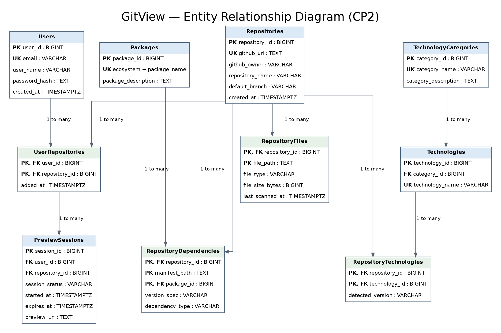
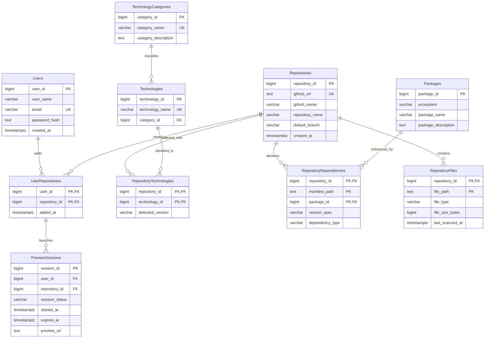

# GitView — Entity Relationship Diagram (CP2)

> **Status:** Proposed conceptual/logical data model for the GitView coursework project.  
> **Basis:** `dbms/01_normalization.md` (CP1). The diagram describes the planned database; it does not claim that the application or these tables are already implemented.

## 1. ER diagram

The diagram source is also provided below in Mermaid ER notation. GitHub renders Mermaid diagrams in Markdown. It can also be previewed in VS Code with a Mermaid-compatible Markdown preview extension.

## 2. Relationship descriptions

| Relationship | Cardinality | Explanation |
|---|---|---|
| `Users` — `UserRepositories` | One-to-many | One user can add many repositories to GitView. |
| `Repositories` — `UserRepositories` | One-to-many | A repository can be added by many users. `UserRepositories` resolves the many-to-many relationship. |
| `UserRepositories` — `PreviewSessions` | One-to-many | A user/repository association can have multiple preview sessions over time. Each session belongs to one association. |
| `TechnologyCategories` — `Technologies` | One-to-many | A category can classify many technologies; each technology belongs to one category. |
| `Repositories` — `RepositoryTechnologies` | One-to-many | A repository can be associated with multiple detected technologies. |
| `Technologies` — `RepositoryTechnologies` | One-to-many | A technology can be detected in multiple repositories. `RepositoryTechnologies` resolves the many-to-many relationship. |
| `Repositories` — `RepositoryDependencies` | One-to-many | A repository can declare many package dependencies, including declarations from different manifest files. |
| `Packages` — `RepositoryDependencies` | One-to-many | A package can be referenced by many repositories. `RepositoryDependencies` stores repository-specific version and dependency-type information. |
| `Repositories` — `RepositoryFiles` | One-to-many | A repository can contain many file records. |

## 3. Primary keys and important constraints

- `Users`: `user_id` is the primary key; `email` is unique.
- `Repositories`: `repository_id` is the primary key; canonical `github_url` is unique.
- `UserRepositories`: composite primary key (`user_id`, `repository_id`).
- `PreviewSessions`: `session_id` is the primary key. The (`user_id`, `repository_id`) foreign key references `UserRepositories`, ensuring a session is associated with a repository the user has added.
- `TechnologyCategories`: `category_id` is the primary key; `category_name` is unique.
- `Technologies`: `technology_id` is the primary key; `technology_name` is unique.
- `RepositoryTechnologies`: composite primary key (`repository_id`, `technology_id`).
- `Packages`: `package_id` is the primary key; (`ecosystem`, `package_name`) is unique.
- `RepositoryDependencies`: composite primary key (`repository_id`, `manifest_path`, `package_id`).
- `RepositoryFiles`: composite primary key (`repository_id`, `file_path`).

## 4. Notes and scope

1. The model follows the entities and relationships proposed in CP1. It is a relational design for PostgreSQL.
2. `UserRepositories`, `RepositoryTechnologies`, and `RepositoryDependencies` are junction/associative entities that represent many-to-many relationships and relationship-specific attributes.
3. `PreviewSessions` references the composite key of `UserRepositories`, so the database can enforce that a user has added a repository before creating a preview session for it.
4. GitHub OAuth account records and refresh-token records are not included in this CP2 model because they were not part of the CP1 entity list. They can be added in a later design revision if the implemented authentication flow requires persistent OAuth/token records.
5. The live execution environment, containers, logs, and AI assistant are not modelled as separate entities in this version. Extend the model only when the implementation requirements are clear.
